**It's great to meet you here! :D**

> I'm a passionate **Backend Developer** and **DevOps Engineer**, always learning and exploring system-level tooling ✨

---

### ☄️ Quick Insights

 

### 🚀 Stacks

---
